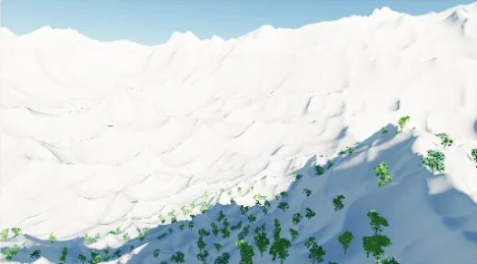
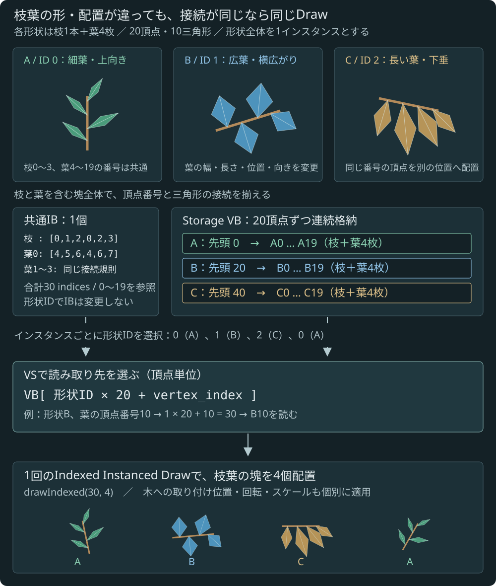

---
title: "RenderingSandbox v03 Renderer"
date: "2026-11-01"
lastmod: "2026-11-01"
layout: "sandbox"
outputs: ["HTML", "Source"]
description: "広葉樹系3樹形のGPU配置・Indirect描画と近中景CSMの検証"
---

学習用にAgentCodingで生成したデモです

[Foliage Modeler](../foliage-modeler/)と同じ生成処理で作った樹木を、GPU上でカメラ周辺から順次配置します。[v03の概要](../) · [版一覧](../../)

[](preview.webp)

実行時の表示例（視点を調整しています）

<!-- demo -->

## 現在の構成と制限

樹木の配置・描画の仕組みを確認する初版です。森林を遠方まで描くためのLODやストリーミングがすべて揃った状態ではありません。

| 項目 | 現在の実装 |
| --- | --- |
| 樹形 | 円錐・卵・しだれの3種。主要枝は各3本、枝葉の取り付けは各24個 |
| 主幹・主要枝LOD | 3段。投影サイズで選択し、Mainはヒステリシス付き |
| 枝葉LOD | 4段。中クラスの64 / 32 / 16 / 6tri。幹とは独立に選択 |
| 枝葉バリエーション | 広葉樹系の扇状・丸い塊・垂れ枝。同じ枝葉LODの3樹形を1 Draw/ビュー/パスへまとめる |
| 樹木の描画範囲 | カメラから水平距離256m以内。距離境界のフェードは未実装 |
| 樹木の影キャスター範囲 | 水平距離384m以内。画面外の木もCSM用にカリングして描画 |
| 配置キャッシュ | 64mチャンクを13×13保持。スロットを再利用し、カメラ周辺から更新 |
| CSM | 4段×1024²、2048² Atlas。**既定256mの近中景用設定** |
| 未実装の機能 | LODモーフ、風、オクルージョンカリング、葉群単位のカリング、モデルの保存・読み込み |

地形の描画範囲は従来どおり最大16kmです。樹木とCSMの検証範囲だけを狭くしています。CSMの最遠距離より先では、地形も樹木もこのShadow Mapによる影を受けません。CSMの距離を広げても、樹木の配置・影キャスター範囲は自動では広がりません。

## 操作とデバッグ

「実行」で開始します。WASDで前後左右、Q/Eで上下、Shiftで加速、ドラッグ・矢印キーで視点回転、ホイールでも前後移動できます。初期視点から少し下を向くと、足元の地形に配置された木を確認できます。地形との衝突判定はないため、地中へ移動することもできます。

樹木枠で表示のON/OFF、密度0〜1、1フレームの生成予算1〜8チャンクを変更します。「カリング・配置を固定」では配置生成と可視リストの更新を止め、観察用カメラだけを動かせます。

- 幹LOD色分け：選ばれた幹LODを表示。枝葉LODとは独立です
- 配置チャンク色分け：木が所属するキャッシュスロットを表示
- Draw色分け：幹は茶、枝葉はLOD別の色。同じ色の枝葉は、形状バリエーションが異なっても同じDrawに含まれます
- 枝葉LOD色分け：幹も含め、木に選択された枝葉LODの色で表示
- 枝葉LOD：自動選択とLOD0〜3固定を切り替え、同じ視点で比較

幹は最大3 Draw、枝葉は最大4 Draw/ビュー/パスです。ZPrePass・Forward・各CSMカスケードは、それぞれ別のDrawです。メトリクスには未生成チャンク数、Mainの幹LOD別木数・枝葉LOD別部品数、CSM各段の木数、GPU常駐メモリを表示します。空のLODもInstance数0のIndirect Drawを発行します。

## 樹木アセットと共有データ

初期化時にCPUで樹木3種、幹3LOD、枝葉3バリエーション、形状別ソケットを生成してGPUへ転送します。円錐・卵・しだれは共通パラメータのプリセットです。主要枝数を3本に揃え、幹はLODごとにuint16 IBを共有し、形状ごとの頂点をStorage VBへ連続格納します。主幹と主要枝の接合は交差管で、溶接した一体メッシュではありません。

枝葉は中クラスを使い、各木の24ソケットへ取り付けます。ソケットと形状IDはLOD間で共通です。枝葉のTri数は次のとおりです。幹は独立した3段LOD（640 / 264 / 104tri）なので、合計は選ばれた幹と枝葉の和です。ZPrePassや影による再描画は重複計上していません。

| 枝葉LOD | 部品1個 | 24個の合計 |
| --- | ---: | ---: |
| 0 | 64tri | 1,536tri |
| 1 | 32tri | 768tri |
| 2 | 16tri | 384tri |
| 3 | 6tri | 144tri |

代表葉の選択と拡大により輪郭とボリューム感を近似します。規模クラスの小・中・大をLODとして流用せず、各クラス・バリエーションから専用の4段LODを生成します。[Modelerの比較と生成方法](../foliage-modeler/#枝葉lod)も参照してください。葉群の代理形状なので、低LODでは葉や枝の接続・輪郭が変化します。遷移モーフはありません。

## Branch cluster Tree

この実験では、主幹・主要枝の骨格へ枝葉の塊（branch cluster）を部品として取り付けて木を構成する方式を、Branch cluster Treeと呼びます。木全体を1種類の固有メッシュとして描くのではなく、再利用する枝葉部品と、その取り付け位置・姿勢・スケールを分けて保持します。

枝葉部品は**同じトポロジなら、形状が異なっていても同じIndexed Instanced Drawにまとめます**。単に頂点数や三角形数が同じという条件ではなく、頂点番号の対応と三角形の接続を同じIBで表せることが条件です。広がり・曲がり・葉の向き・色などは頂点データ側で変えます。



[図を拡大](branch-cluster-instancing.svg)

図では枝1本（4頂点2tri）と葉4枚（各4頂点2tri）を合わせた20頂点10triの塊をA/B/Cの3形状とし、A→B→C→Aの4インスタンスを描きます。Aは細い葉を上向きに、Bは幅広い葉を横へ、Cは長い葉を下へ配置します。塊全体で頂点数と接続順序は同じですが、葉の幅・長さ・位置・向きを大きく変えています。IBは変えず、VSが形状IDから頂点の先頭を選びます。メッシュを1つの形状へ結合する処理や、インスタンスごとに固定機能の`baseVertex`を変更する処理ではありません。図のアドレスは頂点単位で、下記コードではさらに9 float/頂点を掛けます。実装では図の`drawIndexed(30, 4)`に相当する個数をGPUで作り、`drawIndexedIndirect`を発行しています。

| データ | 保持方法 |
| --- | --- |
| 三角形の接続 | クラス内で共通のuint16 IB |
| 位置・法線・色 | 形状バリエーションごとにStorage VBの別領域へ格納 |
| 枝葉形状の選択 | ソケットが持つバリエーションID |
| 配置と変換 | 可視木IDとソケット番号から、木と部品の変換を参照 |

```wgsl
let at = (variation * meshInfo.vertices + id) * 9u;
```

`foliage-geometry.wgsl`のVSでは、固定機能の共有IBから得た`id`（`vertex_index`）に、バリエーションの先頭オフセットを足します。`meshInfo.vertices`は1形状の頂点数、9は位置・法線・リニアRGBのfloat数です。通常の頂点属性としてVBを切り替えるのではなく、VSでStorage Bufferから該当する形状の頂点を読みます。

現状は中クラスの扇状・丸い塊・垂れ枝が、各LOD内で同じトポロジです。GPUは枝葉LODごとに可視木をまとめ、そのLODの共有IBとStorage VBを使って1回の`drawIndexedIndirect`で描画します。インスタンス番号を木番号とソケット番号へ分解し、取り付けごとの形状と変換を選びます。

この1 Drawは**同じ規模クラス・同じLOD・1ビュー・1パス内**の単位です。ZPrePass、Forward、各CSMカスケードでそれぞれ描画します。形状バリエーションや配置本数に比例してDrawを増やさずに済みますが、形状ごとの頂点データと各インスタンスのVS処理は必要です。異なるトポロジや材質まで自動的に同じDrawへまとめる方式ではありません。

## GPUによる配置更新

固定候補スロットは10,816個、根元情報は32 bytes/候補です。GPUがカメラ近傍の未完成チャンクを選び、固定予算内で生成します。完成したチャンクだけを表示し、移動後も重なる領域の配置は保持します。候補位置・採否・形状・方位・スケールは世界セル座標とシードで決まります。

近接候補は隣接セルのハッシュ優先度で間引きます。チャンク境界にも同じ規則を使いますが、厳密なPoisson disk/BlueNoise生成ではありません。急斜面は配置対象から除外します。

Height Clipmapの最細1m段を、標高更新の後に双線形参照します。キャッシュ全体の候補はカメラから各軸448m以内にあり、1024サンプルの最細標高窓内に収まります。世界チャンク座標と生成世代を持つヘッダーで完成済みデータを識別し、地形・密度変更時には古い世代を無効化します。

根元標高は生成後に保持するため、地形メッシュのLOD変更で木が上下しません。ただし、粗い地形ポリゴンと固定した根元の間に接地差が生じる場合はあります。

## GPUカリングとIndirect描画

メインビューと4段のCSMで独立した可視リストを作ります。木全体を保守的な球でカリングし、CSMにはShadowCasterVolumeCullingも適用します。幹LODは投影行列と描画解像度から選択します。Mainは100/35pxを基準としたヒステリシス、CSMは各段の40/12テクセルを基準にしています。

枝葉は最大部品半径の投影サイズを用い、木単位でLODを選びます。Mainの基準は60 / 25 / 10px、CSMは30 / 12 / 4テクセルです。Mainには±15%のヒステリシスを設け、前フレームの枝葉LODを根元バッファへ保持します。個々のソケットごとにLODを変える方式ではありません。

可視リストは各ビューに幹3領域・枝葉4領域を確保します。各領域の容量は最大候補数10,816個です。Workgroup内のprefix sumで圧縮し、非空Workgroupにつき対象LODへ1回だけAtomicAddで領域を予約します。葉のIndirect Instance数はGPUで可視木数×24ソケットへ変換します。

葉のVSは可視木IDとソケット番号から部品を参照し、木とソケットの変換を合成します。木ごとの枝葉形状・ソケット変換の複製や、CPUによるワールド配置展開はありません。可視IDは約296 KiB/ビュー、Indirect引数は140 bytes/ビューです。

ランタイムの配置要求選択・生成・採否・LOD・カリング・Draw引数生成はGPUで行います。非同期読み戻しは進捗表示と、生成が残っている場合のフレーム起床にだけ使い、CPUで可視個数やDraw引数を決めません。非表示タブやカリング固定中は更新を止め、静止して配置生成が完了すると連続描画を止めます。

## 描画パスと照明

標高更新 → 配置生成 → カリング・Indirect引数生成 → ZPrePass → CSM ShadowPass → ForwardShadingPass → PostProcessの順です。ZPrePassとForwardは同じ頂点位置計算・可視リストを使います。

幹は不透明・背面カリング、葉は不透明・両面です。ZOnlyにPSはなく、Forwardにdiscardや深度出力はありません。GGX/Lambert・2次SH・Octahedral Specular IBL・大気遠近法を使い、PreExposure済みHDRを出力します。TonemappingとsRGB変換は後続パスで行います。

## 樹木検証用の近中景CSM

Atlasの構成はv02と同じですが、既定距離を4kmから256mへ絞っています。対数分割90%・線形分割10%で、既定の分割距離は約10.1 / 27.3 / 76.8 / 256mです。近中景の小さな枝葉や幹へテクセルを配分するための設定で、遠景用シャドウの実装ではありません。

深度バイアスはNDC深度の直接指定をやめ、既定0.03mとしました。各カスケードの正射影行列から深度/ワールド距離を求め、Reversed Zの比較値へ換算します。法線バイアスも1mから0.1mへ減らしています。地形と樹木で同じ換算を使います。バイアスとPCFはUIから調整できます。
