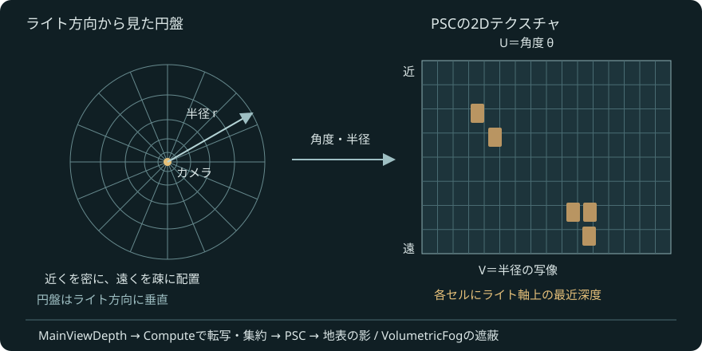

---
title: "RenderingSandbox v05 - PolarShadowCache"
date: "2026-11-01"
lastmod: "2026-11-23"
draft: false
layout: "rust-sandbox"
view_copy: true
preview: "preview.webp"
preview_caption: "地形と検証用の柱を描画し、MainView DepthBufferからPSCを生成した表示例（Windows版）"
description: "MainView DepthBufferから超遠距離の疑似シャドウを再構成し、地形とVolumetricFogへ適用する実験"
---

## PolarShadowCache

超遠距離の影を、MainView DepthBufferから作ってみる実験です。近景はCSM、遠景はPolarShadowCache（PSC）を使い、画面に映った山や柱から長い影を落とします。

### 深度をライト空間へ転写する

カメラを中心に、Directional Lightに垂直な円盤を置きます。MainView DepthBufferの各画素から位置を復元し、円盤上の角度と半径をテクスチャのU・Vへ、ライト軸方向の位置を深度へ変換します。半径方向は近くを密、遠くを疎に配置します。

Compute Shaderで同じセルへ集まる点をReversed ZのAtomicMaxで合成し、ライトに最も近い点を保存します。既定は角度1024×半径1024、外半径16 kmです。メッシュをライト視点でもう一度描く代わりに、メインビューで得た可視面を利用します。

### 地形とフォグから参照する

地形・樹木・検証用の柱では、受光点を同じPSC座標へ写像して深度比較します。4点のPCFと、セルのワールド寸法に応じたキャスターバイアスを備えています。全周のFull Diskと、視野の円錐をライト平面へ投影したView-Fittedを切り替えられます。

VolumetricFogでも同じPSCから太陽光の遮蔽を参照します。カメラからの視線はライト平面上で円盤中心から伸びるので、原則としてUを固定し、V方向へ進むサンプリングができます。既定は縦横1/2解像度・16ステップ・最大16 kmです。

### キャッシュとして残す

Full Diskのキャッシュ維持では、前フレームの深度から点を復元し、今回のカメラとライトに合わせて再投影します。現在のMainViewDepthと矛盾する履歴は除去し、視野内の履歴を徐々にライト軸の奥へ押し込んで更新します。

画面外へ出た遮蔽物を引き継げますが、テクセル中心からの復元誤差と点の散布による穴抜けが残っています。最初から画面に映っていない面や、ほかの面の裏側にある遮蔽物の情報も不足します。完成した遠景シャドウ手法としての品質はまだありません。

### 試すときは

PSCの「シェーディングに適用」とVolumetricFogの「太陽光を遮蔽」を切り替えると、地表の影と空間内の影を確認できます。ワールド空間の円盤、2Dテクスチャ、サーフェイス上のテクセル格子も表示できます。一辺16 kmの四方に置いた高さ3 kmの柱は、長い影を観察するための検証用Primitiveです。

GPU時間の表示と設定のA/B保存はありますが、この手法について十分な最適化や性能比較は行っていません。超遠方までジオメトリを使ってシャドウマップを描く場合に対し、そのジオメトリ負荷を抑えるアイデアとしてのデモです。

### 参考資料

- [Artem Kovalovs, Volumetric Effects of The Last of Us Part II — Naughty Dog, SIGGRAPH 2020](https://www.naughtydog.com/blog/naughty_dog_at_siggraph_2020) ／ [講演スライド](https://s3.amazonaws.com/nd.images/research/2020_siggraph/Volumetrics.pptx)。Sun Shadow Cacheのライト平面上のマッピングと、フォグからの参照を参考にしました。資料ではCSMとSun Shadow Snapshotを入力に使います。今回のMainViewDepthからの転写は、そのキャッシュの考え方を応用した実験です。
- [講演概要 — Volumetric Effects of The Last of Us: Part Two](https://history.siggraph.org/wp-content/uploads/2022/08/2020-Talks-Kovalovs_Volumetric-Effects-of-The-Last-of-Us-Part-Two.pdf)。遠距離のフォグを照らすための中間キャッシュとSnapshotの概要が記載されています。

MainView DepthBufferを流用してShadowCacheを生成してみる、というアイデアの参考にしてもらえれば嬉しいです。
