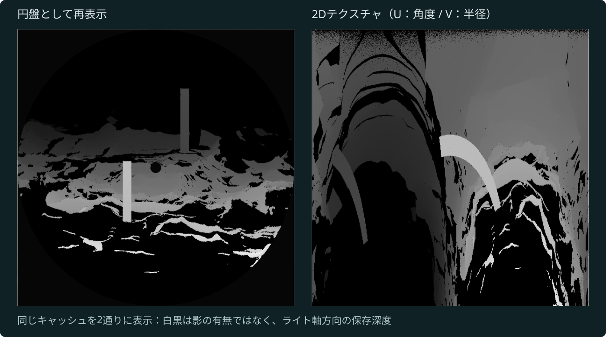
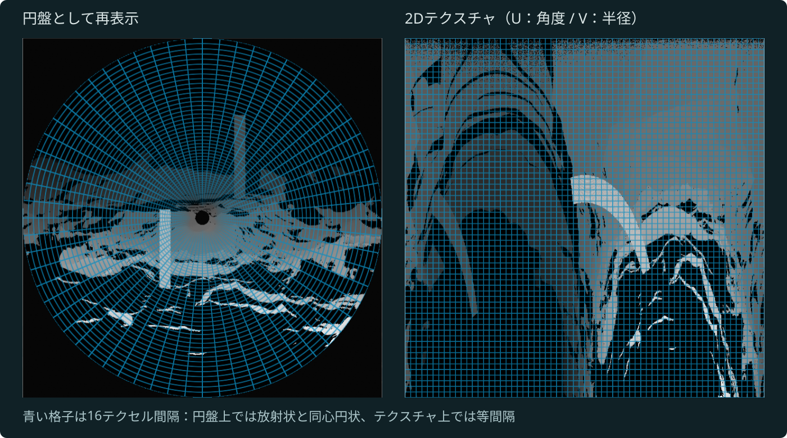
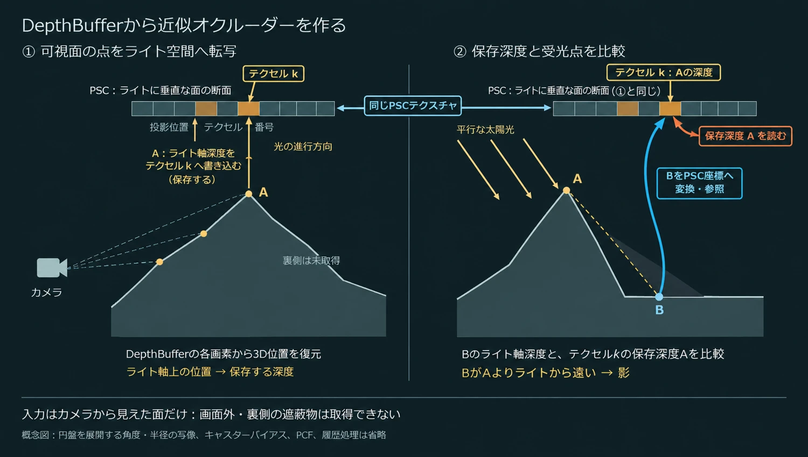

---
title: "RenderingSandbox v05 - PolarShadowCache"
date: "2026-11-01"
lastmod: "2026-11-23"
draft: false
layout: "rust-sandbox"
view_copy: true
preview: "preview.webp"
preview_caption: "PSCによる遠距離シャドウとVolumetricFogの表示例"
description: "MainView DepthBufferから超遠距離の疑似シャドウを再構成し、地形とVolumetricFogへ適用する実験"
---

## PolarShadowCache

超遠距離の影を、MainView DepthBufferから作ってみる実験です。近景はCSM、遠景はPolarShadowCache（PSC）を使い、画面に映った山や柱から長い影を落とします。

[The Last of Us Part IIの講演「Volumetric Effects」](https://www.naughtydog.com/blog/naughty_dog_at_siggraph_2020)で紹介された、扇状のSun Shadow Cacheに着想を得ています。今回はその考え方を円盤状のキャッシュへ広げ、MainView DepthBufferを近似オクルーダーの入力として利用します。

本実験ではPSCのパフォーマンス計測・比較は行っていません。超遠方までジオメトリを描画してシャドウマップを作る代わりに、既存の深度情報を流用するアイデアの検証です。

### 円盤上のテクスチャ配置

カメラを中心に、Directional Lightに垂直な円盤を置きます。円盤上の角度と半径をテクスチャのU・Vへ対応付け、半径方向は近くを密、遠くを疎に配置します。既定は角度1024×半径1024、外半径16 kmです。

実際のPSCを円盤として表示したものが左、角度を横軸U・半径を縦軸Vとする2Dテクスチャが右です。同じキャッシュを異なる座標で表示しています。右では上が内周、下が外周です。

白黒はシャドウの有無ではなく、ライト軸方向の保存深度です。Reversed Zなので明るいほどライトに近く、未書き込みは最遠の0として黒く表示されます。円盤の範囲外も黒です。柱や地形が転写されている様子と、観測できていない部分の穴が分かります。

青い格子は1本ごとに16テクセル間隔です。円盤上では放射状・同心円状となり、遠くほどワールド空間でのセル寸法が大きくなる配置を確認できます。

### DepthBufferから遮蔽物を作る

MainView DepthBufferには、カメラから見えるサーフェイスの深度が入っています。各画素から3D位置を復元し、遮蔽物のサンプル点としてライト空間へ投影します。

投影位置からPSCのテクセルを求め、ライト軸方向の位置を深度として保存します。同じテクセルに複数の点が集まった場合は、ライトに最も近い点を採用します。Compute ShaderではReversed ZのAtomicMaxで集約します。

影を評価するときは、受光点Bも同じPSC座標へ変換し、対象テクセルkの保存深度Aを読みます。BがAよりライトから遠ければ影とする、通常のShadowMapと同じ深度比較です。図ではバイアスとPCFを省略しています。

メッシュをライト視点でもう一度描く代わりに、メインビューで得た可視面を近似オクルーダーとして利用します。画面外や裏側の未観測の面は取得できないため、遮蔽物の情報は不完全です。

### 地形とフォグから参照する

地形・樹木・検証用の柱に同じPSCを適用します。4点のPCFと、セルのワールド寸法に応じたキャスターバイアスを備えています。全周のFull Diskと、視野の円錐をライト平面へ投影したView-Fittedを切り替えられます。

VolumetricFogでも同じPSCから太陽光の遮蔽を参照します。カメラからの視線はライト平面上で円盤中心から伸びるので、原則としてUを固定し、V方向へ進むサンプリングができます。既定は縦横1/2解像度・16ステップ・最大16 kmです。

### キャッシュとして残す

Full Diskのキャッシュ維持では、前フレームの深度から点を復元し、今回のカメラとライトに合わせて再投影します。現在のMainViewDepthと矛盾する履歴は除去し、視野内の履歴を徐々にライト軸の奥へ押し込んで更新します。

画面外へ出た遮蔽物を引き継げますが、テクセル中心からの復元誤差と点の散布による穴抜けが残っています。最初から画面に映っていない面や、ほかの面の裏側にある遮蔽物の情報も不足します。完成した遠景シャドウ手法としての品質はまだありません。

### 試すときは

PSCの「シェーディングに適用」とVolumetricFogの「太陽光を遮蔽」を切り替えると、地表の影と空間内の影を確認できます。ワールド空間の円盤、2Dテクスチャ、サーフェイス上のテクセル格子も表示できます。一辺16 kmの四方に置いた高さ3 kmの柱は、長い影を観察するための検証用Primitiveです。

GPU時間の表示と設定のA/B保存を備えていますが、PSCの性能評価や最適化は未実施です。ジオメトリ負荷を抑える可能性を試すデモであり、高速化の効果を実測で示したものではありません。

### 参考資料

- [Artem Kovalovs, Volumetric Effects of The Last of Us Part II — Naughty Dog, SIGGRAPH 2020](https://www.naughtydog.com/blog/naughty_dog_at_siggraph_2020) ／ [講演スライド](https://s3.amazonaws.com/nd.images/research/2020_siggraph/Volumetrics.pptx)。Sun Shadow Cacheのライト平面上のマッピングと、フォグからの参照を参考にしました。資料ではCSMとSun Shadow Snapshotを入力に使います。今回のMainViewDepthからの転写は、そのキャッシュの考え方を応用した実験です。
- [講演概要 — Volumetric Effects of The Last of Us: Part Two](https://history.siggraph.org/wp-content/uploads/2022/08/2020-Talks-Kovalovs_Volumetric-Effects-of-The-Last-of-Us-Part-Two.pdf)。遠距離のフォグを照らすための中間キャッシュとSnapshotの概要が記載されています。

MainView DepthBufferを流用してShadowCacheを生成してみる、というアイデアの参考にしてもらえれば嬉しいです。
